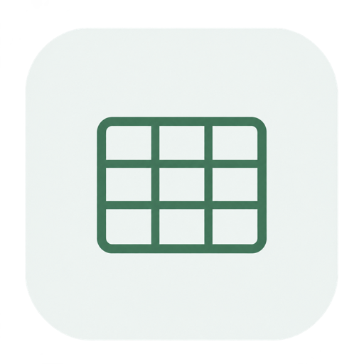

# DOCX Lite & XLSX Lite

Two tiny native macOS apps to open and edit Word and Excel files without installing a full office suite. Native Swift, no dependencies, under 2 MB per app, universal (Apple Silicon + Intel).

| | App | What it does |
|---|---|---|
|  | [**DOCX Lite**](docx-lite/) | A small Google-Docs-style editor for `.docx` (also opens `.doc`, `.odt`, `.rtf`): styles (Normal text, Title, Headings), fonts and sizes, bold/italic/underline, text and highlight color, links, images, alignment, line spacing, bulleted / numbered lists and checklists, indent, paint format, clear formatting, find & replace, spell check, word count, print and export to PDF. Saves real Word tables, lists, headings and images. |
|  | [**XLSX Lite**](xlsx-lite/) | A small Google-Sheets-style editor for `.xlsx` / `.xlsm`: name box and formula bar, typing straight into cells, range selection with sum / average / count, copy & paste with Excel / Numbers / Sheets, sort, filters, fill handle and fill down, number formats (€, %, decimals, dates), bold / italic / strikethrough, text and fill color, alignment, wrap, Σ quick functions, freeze first row, ~70 formulas. Opens a 20,000-row sheet in about 2 seconds. |

The interface follows your Mac's language: Italian or English.

 

## Formulas in XLSX Lite

Type a formula in a cell or in the formula bar starting with `=`, in English or Italian syntax: `=SUM(A2:A100)`, `=SOMMA(A2:A100)`, `=CERCA.VERT(A2;Dati!A:C;3;FALSO)`. It is saved in standard Excel syntax, and every formula on the sheet is recalculated after each edit.

Calculated in the app: `+ - * / ^ % &`, comparisons, cell, range and whole-column references (also across sheets), wildcards in criteria, and these functions (Italian names work too): SUM, AVERAGE, MIN, MAX, MEDIAN, PRODUCT, COUNT, COUNTA, COUNTBLANK, SUMIF(S), COUNTIF(S), AVERAGEIF(S), MAXIFS, MINIFS, IF, IFS, IFERROR, AND, OR, NOT, ISERROR, ISNUMBER, ISTEXT, ISBLANK…, VLOOKUP, HLOOKUP, XLOOKUP, INDEX, MATCH, RANK, ROUND(UP/DOWN), INT, ABS, SQRT, POWER, MOD, LEFT, RIGHT, MID, FIND, SEARCH, SUBSTITUTE, TEXTJOIN, CONCATENATE, LEN, UPPER, LOWER, TRIM, VALUE, DATE, YEAR, MONTH, DAY, WEEKDAY, EDATE, EOMONTH, TODAY, NOW. Formulas using other functions keep the value Excel saved, so nothing is shown wrong.

## Download

Get the zipped apps from the [latest release](https://github.com/lucasflati12/docx-xlsx-lite/releases/latest), unzip them and drag them into Applications.

The apps are free and not signed with a paid Apple Developer ID, so the first time macOS says it can't verify the developer. To open them anyway:

- **macOS 15 or later:** try to open the app once, then go to **System Settings → Privacy & Security** and click **Open Anyway**.
- **macOS 13–14:** right-click the app → **Open** → **Open**.

Or build them yourself from the source (below): apps you compile on your own Mac open without warnings.

## Build from source

Requires macOS 13 or later and the Xcode Command Line Tools (`xcode-select --install`).

```bash
git clone https://github.com/lucasflati12/docx-xlsx-lite.git
cd docx-xlsx-lite
bash docx-lite/build.sh   # → ~/Desktop/DOCX Lite.app
bash xlsx-lite/build.sh   # → ~/Desktop/XLSX Lite.app
```

Pass a path to build somewhere else, e.g. `bash docx-lite/build.sh "/Applications/DOCX Lite.app"`. Then right-click a file → **Open With** to use them.

## Keyboard shortcuts

| | DOCX Lite | XLSX Lite |
|---|---|---|
| New / open / save / save as | ⌘N ⌘O ⌘S ⇧⌘S | ⌘N ⌘O ⌘S ⇧⌘S (save a copy) |
| Undo / redo | ⌘Z ⇧⌘Z | ⌘Z ⇧⌘Z |
| Find | ⌘F, ⌘G, ⇧⌘G | ⌘F, ⌘G, ⇧⌘G |
| Format | ⌘B ⌘I ⌘U, ⌘K link, ⇧⌘7 / ⇧⌘8 lists, ⌘[ ⌘] indent, ⌘\ clear | ⌘B ⌘I |
| Spreadsheet | | type to edit, Return / Tab to move, Esc to cancel, Delete to clear, ⇧+arrows to select, ⌘C / ⌘X / ⌘V ranges |
| Print / PDF | ⌘P, ⇧⌘E export PDF | ⌘P |

## Limits

- DOCX Lite is not Word: headers/footers, footnotes, comments, tracked changes and complex layouts are not edited, and saving a Word file with them may drop them. The app warns you the first time and offers Save a Copy.
- XLSX Lite does not insert/delete rows or columns, draw charts or run macros. Pasted formulas are not re-referenced, and sorting is refused on ranges that contain formulas or merged cells.
- Very large sheets show the first ~400,000 cells. Password-protected files are not supported.

## Tests

```bash
# DOCX Lite
cd docx-lite
python3 test-fixtures.py /tmp/docxlite-tests
xcrun swiftc -D DEBUG -swift-version 5 main.swift ReaderTests.swift -o /tmp/docxlite-tests/ReaderTests
/tmp/docxlite-tests/ReaderTests --smoke-test /tmp/docxlite-tests/rich.docx

# XLSX Lite (the fixture needs: pip install openpyxl)
cd ../xlsx-lite
python3 test-fixture.py /tmp/xlsxlite-tests
xcrun swiftc -D DEBUG -swift-version 5 main.swift SheetTests.swift -o /tmp/xlsxlite-tests/SheetTests
/tmp/xlsxlite-tests/SheetTests --smoke-test /tmp/xlsxlite-tests/big.xlsx
```

## License

MIT, see [LICENSE](LICENSE).

---

Independent project, not affiliated with or endorsed by Microsoft. Microsoft, Word and Excel are trademarks of Microsoft Corporation, mentioned only to describe file compatibility.
