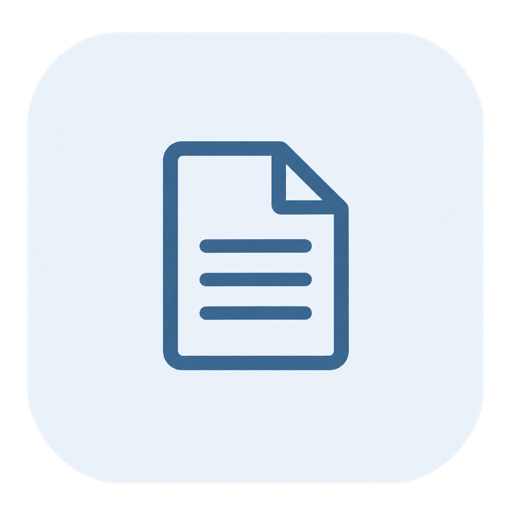
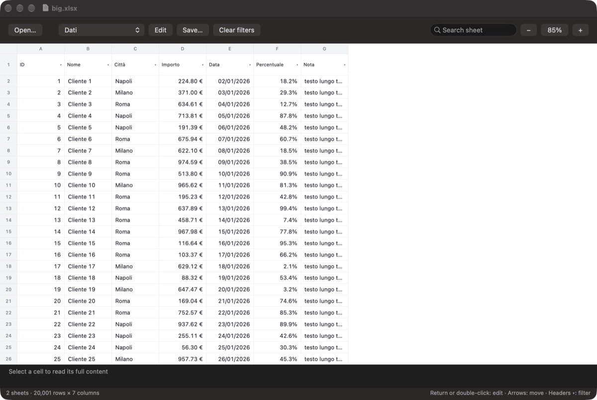
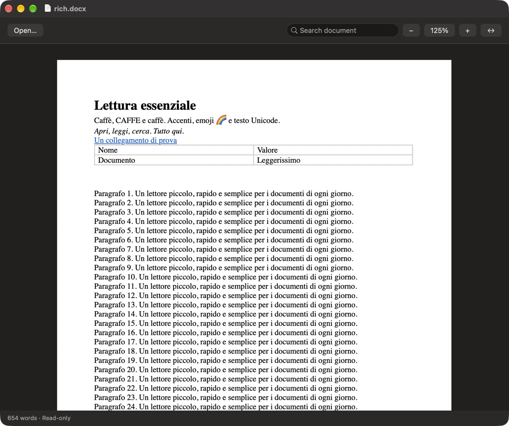

# DOCX Lite & XLSX Lite

Two tiny native macOS apps to open Word and Excel files without installing a full office suite. One Swift file each, no dependencies, about 1 MB per app, universal (Apple Silicon + Intel).

| | App | What it does |
|---|---|---|
|  | [**DOCX Lite**](docx-lite/) | Reads `.docx`, `.doc`, `.odt` and `.rtf`: text, formatting, tables, images, links. Search, zoom, copy, print and export to PDF. Read-only: the original file is never changed. |
|  | [**XLSX Lite**](xlsx-lite/) | Opens `.xlsx` and `.xlsm`: all sheets, cell styles, number and date formats, merged cells, frozen panes, column filters. Move with the arrow keys, edit a cell with Return, write formulas, undo, save a copy, print. Opens a 20,000-row sheet in about 2 seconds. |

The interface follows your Mac's language: Italian or English.

 

## Formulas in XLSX Lite

Type a formula in a cell starting with `=`, in English or Italian syntax: `=SUM(A2:A100)`, `=SOMMA(A2:A100)`, `=SE(B2>100;"sì";"no")`. It is saved in standard Excel syntax, and every formula on the sheet is recalculated after each edit.

Calculated in the app: `+ - * / ^ % &`, comparisons, cell and range references (also across sheets), `SUM` `AVERAGE` `MIN` `MAX` `MEDIAN` `PRODUCT` `COUNT` `COUNTA` `SUMIF` `COUNTIF` `AVERAGEIF` `IF` `IFERROR` `AND` `OR` `NOT` `ROUND` `ROUNDUP` `ROUNDDOWN` `INT` `ABS` `SQRT` `POWER` `MOD` `CONCATENATE` `LEN` `UPPER` `LOWER` `TRIM` `TODAY` (and their Italian names: `SOMMA`, `MEDIA`, `SE`, `CONTA.SE`, `SOMMA.SE`, `ARROTONDA`…).

## Download

Get the zipped apps from the [latest release](https://github.com/lucasflati12/docx-xlsx-lite/releases/latest), unzip them and drag them into Applications.

The apps are free and not signed with a paid Apple Developer ID, so the first time macOS says it can't verify the developer. To open them anyway:

- **macOS 15 or later:** try to open the app once, then go to **System Settings → Privacy & Security** and click **Open Anyway**.
- **macOS 13–14:** right-click the app → **Open** → **Open**.

Or build them yourself from the source (below): apps you compile on your own Mac open without warnings.

## Build from source

Requires macOS 13 or later and the Xcode Command Line Tools (`xcode-select --install`).

```bash
git clone https://github.com/lucasflati12/docx-xlsx-lite.git
cd docx-xlsx-lite
bash docx-lite/build.sh   # → ~/Desktop/DOCX Lite.app
bash xlsx-lite/build.sh   # → ~/Desktop/XLSX Lite.app
```

Pass a path to build somewhere else, e.g. `bash docx-lite/build.sh "/Applications/DOCX Lite.app"`. Then right-click a file → **Open With** to use them.

## Keyboard shortcuts

| | DOCX Lite | XLSX Lite |
|---|---|---|
| Open / recent files | ⌘O, File → Open Recent | ⌘O, File → Open Recent |
| Find, next, previous | ⌘F, ⌘G, ⇧⌘G | ⌘F, ⌘G, ⇧⌘G |
| Zoom | ⌘+ ⌘− ⌘0, fit width ⌘9 | ⌘+ ⌘− ⌘0 |
| Print | ⌘P (export PDF: ⇧⌘E) | ⌘P |
| Spreadsheet | | arrows / Tab to move, Return to edit, ⌘C to copy a cell, ⌥⌘] / ⌥⌘[ next/previous sheet, ⌘S save a copy |

## Limits

- No exact Word layout: floating objects, headers/footers, charts and equations may look different than in Microsoft Word. Images are shown for `.docx` files.
- Other functions, named ranges and shared or array formulas keep the value Excel saved in the file; Excel recalculates everything when it opens a file saved by XLSX Lite. Edits are always saved as a copy, the original is never changed.
- Very large sheets show the first ~400,000 cells.
- Password-protected files are not supported.

## Tests

```bash
# DOCX Lite
cd docx-lite
python3 test-fixtures.py /tmp/docxlite-tests
xcrun swiftc -D DEBUG -swift-version 5 main.swift ReaderTests.swift -o /tmp/docxlite-tests/ReaderTests
/tmp/docxlite-tests/ReaderTests --smoke-test /tmp/docxlite-tests/rich.docx

# XLSX Lite (the fixture needs: pip install openpyxl)
cd ../xlsx-lite
python3 test-fixture.py /tmp/xlsxlite-tests
xcrun swiftc -D DEBUG -swift-version 5 main.swift SheetTests.swift -o /tmp/xlsxlite-tests/SheetTests
/tmp/xlsxlite-tests/SheetTests --smoke-test /tmp/xlsxlite-tests/big.xlsx
```

## License

MIT, see [LICENSE](LICENSE).

---

Independent project, not affiliated with or endorsed by Microsoft. Microsoft, Word and Excel are trademarks of Microsoft Corporation, mentioned only to describe file compatibility.
